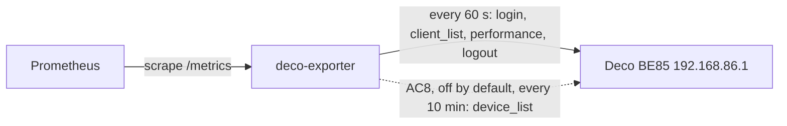

# deco-exporter-docker

Prometheus exporter for per-client traffic on a TP-Link Deco mesh, read from
the main Deco's local admin API. Image build repo; the Kubernetes manifests
live in [`dvystrcil/deco-exporter`](https://github.com/dvystrcil/deco-exporter).

Why it exists: on 2026-11-04 Brave and Google flagged the home IP, and nothing
could say which LAN device was sending what. Pi-hole shows who looks up what,
not bytes; the Decos don't answer SNMP. Tracking issue:
[dvystrcil/homelab#1931](https://github.com/dvystrcil/homelab/issues/1931).



## How it talks to the router

Login is TP-Link's RSA/AES `luci` scheme, through
[`tplinkrouterc6u`](https://pypi.org/project/tplinkrouterc6u/) 5.38.0's
`TPLinkDecoClient`. The wheel is pinned by sha256 in the hashed
`requirements.txt` and installed wheels-only; CI fails if the vetted hash
disappears from the lock.

Each poll is one short session: log in, read, log out. The Deco allows one
admin session, so holding it open would lock the Deco app out.

| Endpoint | When | Why |
|---|---|---|
| `admin/client?form=client_list` | every poll | per-client `up_speed` / `down_speed` |
| `admin/network?form=performance` | every poll | router CPU and memory |
| `admin/device?form=device_list` | only if `DECO_MESH_STATS_ENABLED`, at most every 5 min | mesh link stats (AC8) |

`device_list` is the call reported to briefly interrupt wireless backhaul on
some firmware. Our MAIN↔CORE backhaul is Wi-Fi MLO and already the weak link
(homelab#1802), so it stays off until a side-by-side measurement says it is
safe. The library's `get_status()`, `get_firmware()` and `get_mesh_nodes()`
are never called; they make extra reads, including `device_list`.

On any error the exporter logs in again with a fresh session and retries once.
`device_list` is never retried.

## Metrics

| Metric | Labels | Meaning |
|---|---|---|
| `deco_scrape_success` | | 1 if the last poll succeeded **and** is recent (within 3 intervals) |
| `deco_last_success_timestamp_seconds` | | Unix time of the last good poll |
| `deco_scrape_duration_seconds` | | wall time of the last poll |
| `deco_client_up_speed_raw` | `mac`, `ip`, `name`, `connection`, `interface` | `up_speed` as reported, online clients only |
| `deco_client_down_speed_raw` | same | `down_speed` as reported |
| `deco_clients` | `state` = `online`/`offline` | client-list counts |
| `deco_cpu_usage`, `deco_memory_usage` | | as reported (`cpu_usage`, `mem_usage`) |
| `deco_mesh_stats_enabled` | | 1 if AC8's `device_list` read is on |
| `deco_mesh_scrape_success` | | last `device_list` read OK (only when enabled) |
| `deco_mesh_node_info` | `mac`, `name`, `role`, `model`, `parent_mac`, `firmware` | one per Deco unit |
| `deco_mesh_node_connected` | `mac` | `group_status == connected` |
| `deco_mesh_node_backhaul_signal_dbm` | `mac`, `band` | uplink signal per band |
| `deco_mesh_node_backhaul_rate_raw` | `mac`, `band`, `direction` | uplink link rate as reported |

> **`up_speed`/`down_speed` are kbit/s (decimal).** Calibrated on 2026-11-05
> (BE85, firmware 1.3.0 Build 26090112) with `bin/calibrate-units.py`: a
> download held at 5 MiB/s (41.87 Mbit/s) read 44,244–46,070, so the Deco
> reports ~8% above curl's payload rate (it counts headers). That's **not** the
> kB/s the HA integration assumes, which would be 8× off. The metrics keep the
> `_raw` suffix until a rename or recording rule carries the unit (homelab#1931).
> The figure ramps over ~2 polls, so a short burst reads low.

A failed or stale poll exports `deco_scrape_success 0` and **no** client,
router or mesh series: never the last good values, which would hide the
outage, and never zeros, which would look like a quiet network.

There are no WAN totals: the only WAN endpoint (`wan_ipv4`) carries addresses,
not traffic. Sum the client rates for a WAN estimate.

## Configuration

All from the environment. The password is never a CLI argument.

| Variable | Default | |
|---|---|---|
| `DECO_PASSWORD` | (required) | from a Secret; exits 2 if unset |
| `DECO_HOST` | `http://192.168.86.1` | |
| `DECO_USERNAME` | `admin` | |
| `DECO_POLL_INTERVAL_SECONDS` | `60` | minimum 15 |
| `DECO_TIMEOUT_SECONDS` | `10` | per HTTP request |
| `DECO_MESH_STATS_ENABLED` | `false` | AC8; see above before turning on |
| `DECO_MESH_INTERVAL_SECONDS` | `600` | minimum 300 |
| `LISTEN_PORT` | `9850` | serves `/metrics` and `/healthz` |
| `LOG_LEVEL` | `INFO` | |

## Tests

```bash
uv venv .venv -p 3.15
uv pip install -p .venv --require-hashes --only-binary :all: -r requirements.txt pytest
.venv/bin/pytest -q tests            # unit tests, recorded fixtures, no network
docker build -t deco-exporter:local . && bin/smoke-test.sh deco-exporter:local
bin/receipt-live.sh                  # against the DEPLOYED pod and the real router
bin/calibrate-units.py run           # re-pin the speed unit: ~7 min, 2 GiB download on THIS host
```

Fixtures come from the library's own recorded Deco responses
([tests/fixtures/README.md](tests/fixtures/README.md)), not from our router.

Regenerate the lock with
`uv pip compile --universal --python-version 3.15 --generate-hashes requirements.in -o requirements.txt`.

## License

[MIT](LICENSE).
